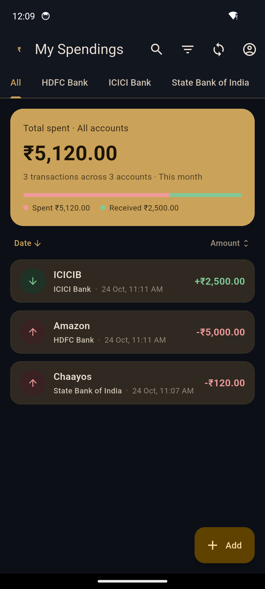
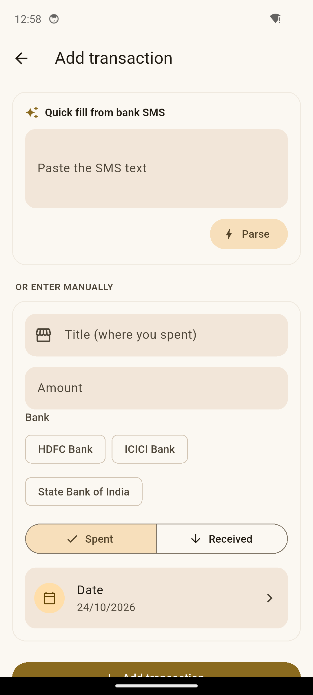
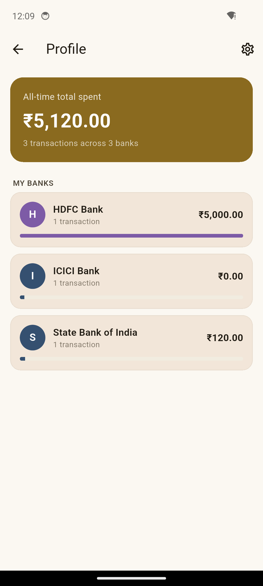
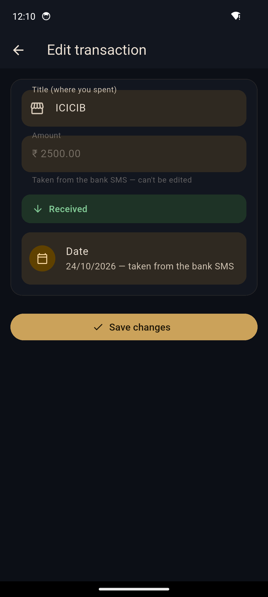

# Kharcha

**Kharcha** ("ख़र्चा" — Hindi for "expense") is a personal expense tracker for UPI-heavy spending in India. On Android, it reads your bank's transaction SMS automatically and logs every spend and credit without you lifting a finger. On iOS, where apps can't read SMS, it falls back to a one-tap "paste the message" flow — and a Share Extension that lets you send a message straight from Messages into the app.

No manual expense sheets, no forgetting to log a UPI payment, no typing out every transaction by hand.

<p align="center">
  
  
  
  
</p>

## What it does

- **Auto-logs bank SMS on Android** — listens for incoming SMS in the background and parses transaction messages from bank sender IDs (never from personal numbers), extracting the amount, merchant, date, and whether money went out or came in.
- **Multi-bank tabs** — every distinct bank your SMS comes from gets its own tab automatically, plus an "All" view, with friendly bank names instead of raw sender codes like `HDFCBK`.
- **Manual entry + Share Extension on iOS** — paste a bank SMS into the app, or select it in Messages and share it straight into Kharcha; either way it's parsed the same way, including a best-effort guess at which bank it's from since iOS never exposes the real sender.
- **Data integrity on auto-logged transactions** — once a transaction is pulled from a real SMS, only its title can be edited afterward; the amount, date, and type are treated as facts, not guesses.
- **Date-range filtering** — defaults to the current month, paginated 10 at a time, with a custom date-range picker that shows everything in range unpaginated.
- **Search, sort, and filter** — by title, by date or amount, by debits/credits only.
- **Light and dark themes** ("Midnight Ledger") with a single toggle, no "auto" mode to second-guess.
- **Delete, deliberately constrained** — auto-logged transactions can never be deleted individually (only "Clear all" in Settings resets everything); manual entries can be deleted, but only from inside the edit screen, behind a confirmation dialog.

## Why

Tracking UPI spending by hand is tedious enough that nobody actually keeps it up. Every bank already sends an SMS the instant money moves — this app just reads that SMS and turns it into a running ledger, so the tracking happens automatically and the only manual work left is the occasional non-SMS transaction.

## Built entirely through AI pair-programming

Every line of this app — the Flutter/Dart code, the Android SMS listener, the native iOS Share Extension in Swift, the Xcode project wiring — was written by [Claude](https://claude.com/claude-code), not by hand. The process was conversational: describe what's needed in plain language, review what comes back running on a real device, point out what's wrong or what should change, repeat.

That loop covered the entire build, including the parts that usually require the most hands-on platform expertise:

- Diagnosing and fixing native Android Gradle/Kotlin toolchain issues that blocked the build entirely
- Writing the regex-based SMS parser (amount/title/type extraction) from scratch and fixing real parsing bugs found by testing against actual bank SMS formats
- Generating the app icon and adaptive Android launcher icons programmatically
- Building and debugging a native iOS Share Extension from scratch — a new Xcode target, App Group entitlements, a Swift `SLComposeServiceViewController`, and a Flutter method channel to bridge the two — including tracking down a missing `PRODUCT_NAME` build setting and a Flutter-vs-CocoaPods build-phase ordering cycle that only showed up once the extension was embedded
- Live-testing every feature end-to-end on an Android emulator (via `adb`) and a physical iPhone (via `flutter run` and `devicectl`) rather than just trusting that the code compiled

Nothing here is a code generator's first draft left untouched — every feature went through real usage, real bug reports, and real fixes before landing.

## Tech stack

- **Flutter / Dart** — cross-platform UI and app logic
- **Provider** — state management
- **sqflite** — local on-device storage, no backend/server at all
- **another_telephony** — Android SMS reading and background listening
- **shared_preferences** — persisted settings (theme, clear-data cutoff)
- Native **Swift** iOS Share Extension + App Group + `FlutterMethodChannel` for the Messages → Kharcha handoff

## Platform differences

| | Android | iOS |
|---|---|---|
| Auto-reads bank SMS | ✅ | ❌ (not permitted by iOS) |
| Manual paste + parse | ✅ | ✅ |
| Share from Messages | — | ✅ (Share Extension) |
| Bank identified by | real SMS sender | best-effort text match |

## Running it locally

```bash
flutter pub get
flutter run -d <device-id>   # Android emulator/device or iOS simulator/device
```

iOS requires an Apple ID signing team set in `ios/Runner.xcodeproj` (free personal teams work for local testing, but installs expire after 7 days — a paid Apple Developer account extends that to a year).

## About

Built by [@Pruthvikhartmol](https://github.com/Pruthvikhartmol).
